  

  

---

### Socials

  <a href="https://github.com/kazanaruishere-max" target="_blank" rel="noreferrer">
    <picture>
      <source media="(prefers-color-scheme: dark)" srcset="https://raw.githubusercontent.com/danielcranney/readme-generator/main/public/icons/socials/github-dark.svg" />
      <source media="(prefers-color-scheme: light)" srcset="https://raw.githubusercontent.com/danielcranney/readme-generator/main/public/icons/socials/github.svg" />
      
    </picture>
  </a>
  <a href="https://www.linkedin.com/in/azka-syahirull-a647993b6/" target="_blank" rel="noreferrer">
    <picture>
      <source media="(prefers-color-scheme: dark)" srcset="https://raw.githubusercontent.com/danielcranney/readme-generator/main/public/icons/socials/linkedin-dark.svg" />
      <source media="(prefers-color-scheme: light)" srcset="https://raw.githubusercontent.com/danielcranney/readme-generator/main/public/icons/socials/linkedin.svg" />
      
    </picture>
  </a>
  <a href="https://www.x.com/kazanaruishere" target="_blank" rel="noreferrer">
    <picture>
      <source media="(prefers-color-scheme: dark)" srcset="https://raw.githubusercontent.com/danielcranney/readme-generator/main/public/icons/socials/twitter-dark.svg" />
      <source media="(prefers-color-scheme: light)" srcset="https://raw.githubusercontent.com/danielcranney/readme-generator/main/public/icons/socials/twitter.svg" />
      
    </picture>
  </a>
  <a href="http://www.instagram.com/kazanaru" target="_blank" rel="noreferrer">
    <picture>
      <source media="(prefers-color-scheme: dark)" srcset="https://raw.githubusercontent.com/danielcranney/readme-generator/main/public/icons/socials/instagram-dark.svg" />
      <source media="(prefers-color-scheme: light)" srcset="https://raw.githubusercontent.com/danielcranney/readme-generator/main/public/icons/socials/instagram.svg" />
      
    </picture>
  </a>
  <a href="https://discord.gg/kazanaru" target="_blank" rel="noreferrer">
    <picture>
      <source media="(prefers-color-scheme: dark)" srcset="https://raw.githubusercontent.com/danielcranney/readme-generator/main/public/icons/socials/discord-dark.svg" />
      <source media="(prefers-color-scheme: light)" srcset="https://raw.githubusercontent.com/danielcranney/readme-generator/main/public/icons/socials/discord.svg" />
      
    </picture>
  </a>

---

### 📊 GitHub Metrics

  

---

### 👷 Currently Working On

- [kazanaruishere-max/Opencode-Config](https://github.com/kazanaruishere-max/Opencode-Config) - 
- [kazanaruishere-max/Test-soal-LKS-AI-ENGINEER](https://github.com/kazanaruishere-max/Test-soal-LKS-AI-ENGINEER) - 
- [IDARRRZ/agate-game](https://github.com/IDARRRZ/agate-game) - 
- [kazanaruishere-max/SEITH-MARKET-IDX](https://github.com/kazanaruishere-max/SEITH-MARKET-IDX) - SEITH AI UNTUK HACKATON MARKET IDX
- [kazanaruishere-max/SEITH-TRADER-X-KRONOS-MODEL](https://github.com/kazanaruishere-max/SEITH-TRADER-X-KRONOS-MODEL) - 

### 🌱 Latest Projects

- [kazanaruishere-max/SEITH-WARDEN](https://github.com/kazanaruishere-max/SEITH-WARDEN) - 
- [kazanaruishere-max/Test-soal-LKS-AI-ENGINEER](https://github.com/kazanaruishere-max/Test-soal-LKS-AI-ENGINEER) - 
- [kazanaruishere-max/SEITH-MARKET-IDX](https://github.com/kazanaruishere-max/SEITH-MARKET-IDX) - SEITH AI UNTUK HACKATON MARKET IDX
- [kazanaruishere-max/Proxy-Opencode](https://github.com/kazanaruishere-max/Proxy-Opencode) - 
- [kazanaruishere-max/Opencode-Config](https://github.com/kazanaruishere-max/Opencode-Config) - 

### 🔨 Recent Pull Requests

- [docs: add 10 critical engineering Q&amp;As and vendor repository links in README](https://github.com/kazanaruishere-max/SEITH-MARKET-IDX/pull/53) on [kazanaruishere-max/SEITH-MARKET-IDX](https://github.com/kazanaruishere-max/SEITH-MARKET-IDX)
- [docs: condense 3-minute video script to 299 words for ~2m50s ElevenLabs timing](https://github.com/kazanaruishere-max/SEITH-MARKET-IDX/pull/52) on [kazanaruishere-max/SEITH-MARKET-IDX](https://github.com/kazanaruishere-max/SEITH-MARKET-IDX)
- [docs: add 3-minute video demo script and storyboard for elevenlabs](https://github.com/kazanaruishere-max/SEITH-MARKET-IDX/pull/51) on [kazanaruishere-max/SEITH-MARKET-IDX](https://github.com/kazanaruishere-max/SEITH-MARKET-IDX)
- [fix(web): fallback to nested anomaly z and flag in RankingTable](https://github.com/kazanaruishere-max/SEITH-MARKET-IDX/pull/50) on [kazanaruishere-max/SEITH-MARKET-IDX](https://github.com/kazanaruishere-max/SEITH-MARKET-IDX)
- [feat(web): ssot displayScore, remove hardcode caps, and qualify docs](https://github.com/kazanaruishere-max/SEITH-MARKET-IDX/pull/49) on [kazanaruishere-max/SEITH-MARKET-IDX](https://github.com/kazanaruishere-max/SEITH-MARKET-IDX)

### ⭐ Recent Stars

- [qybaihe/bla](https://github.com/qybaihe/bla) - 🛡️ BLA (bla-agents / Blind LLM Agents) — Open-source Blue Defense MCP server &amp; CLI protecting JS/TS, Electron ASAR, WASM, Python, Native Binaries, SQLite, GGUF/Safetensors &amp; Android DEX against AI reverse-engineering agents (REA).
- [0xemmkty/QuantMuse](https://github.com/0xemmkty/QuantMuse) - A comprehensive quantitative trading system with AI-powered analysis, real-time data processing, and advanced risk management
- [google-research/timesfm](https://github.com/google-research/timesfm) - TimesFM (Time Series Foundation Model) is a pretrained time-series foundation model developed by Google Research for time-series forecasting.
- [shadcn/improve](https://github.com/shadcn/improve) - Use your most capable model to audit your codebase and write plans for cheaper models to execute.
- [horizon-rust/horizon](https://github.com/horizon-rust/horizon) - Minecraft: Java Edition 26.3 rewritten from scratch in Rust, checked against vanilla with 281 differential harnesses. Get it with the Horizon launcher.

---

### 📫 How to reach me

- **Instagram** : [https://instagram.com/kazanaru](https://instagram.com/kazanaru)
