  

  

---

### Socials

  <a href="https://github.com/kazanaruishere-max" target="_blank" rel="noreferrer">
    <picture>
      <source media="(prefers-color-scheme: dark)" srcset="https://raw.githubusercontent.com/danielcranney/readme-generator/main/public/icons/socials/github-dark.svg" />
      <source media="(prefers-color-scheme: light)" srcset="https://raw.githubusercontent.com/danielcranney/readme-generator/main/public/icons/socials/github.svg" />
      
    </picture>
  </a>
  <a href="https://www.linkedin.com/in/azka-syahirull-a647993b6/" target="_blank" rel="noreferrer">
    <picture>
      <source media="(prefers-color-scheme: dark)" srcset="https://raw.githubusercontent.com/danielcranney/readme-generator/main/public/icons/socials/linkedin-dark.svg" />
      <source media="(prefers-color-scheme: light)" srcset="https://raw.githubusercontent.com/danielcranney/readme-generator/main/public/icons/socials/linkedin.svg" />
      
    </picture>
  </a>
  <a href="https://www.x.com/kazanaruishere" target="_blank" rel="noreferrer">
    <picture>
      <source media="(prefers-color-scheme: dark)" srcset="https://raw.githubusercontent.com/danielcranney/readme-generator/main/public/icons/socials/twitter-dark.svg" />
      <source media="(prefers-color-scheme: light)" srcset="https://raw.githubusercontent.com/danielcranney/readme-generator/main/public/icons/socials/twitter.svg" />
      
    </picture>
  </a>
  <a href="http://www.instagram.com/kazanaru" target="_blank" rel="noreferrer">
    <picture>
      <source media="(prefers-color-scheme: dark)" srcset="https://raw.githubusercontent.com/danielcranney/readme-generator/main/public/icons/socials/instagram-dark.svg" />
      <source media="(prefers-color-scheme: light)" srcset="https://raw.githubusercontent.com/danielcranney/readme-generator/main/public/icons/socials/instagram.svg" />
      
    </picture>
  </a>
  <a href="https://discord.gg/kazanaru" target="_blank" rel="noreferrer">
    <picture>
      <source media="(prefers-color-scheme: dark)" srcset="https://raw.githubusercontent.com/danielcranney/readme-generator/main/public/icons/socials/discord-dark.svg" />
      <source media="(prefers-color-scheme: light)" srcset="https://raw.githubusercontent.com/danielcranney/readme-generator/main/public/icons/socials/discord.svg" />
      
    </picture>
  </a>

---

### 📊 GitHub Metrics

  

---

### 👷 Currently Working On

- [kazanaruishere-max/AETERNA](https://github.com/kazanaruishere-max/AETERNA) - 
- [kazanaruishere-max/Opencode-Config](https://github.com/kazanaruishere-max/Opencode-Config) - 
- [kazanaruishere-max/Test-soal-LKS-AI-ENGINEER](https://github.com/kazanaruishere-max/Test-soal-LKS-AI-ENGINEER) - 
- [IDARRRZ/agate-game](https://github.com/IDARRRZ/agate-game) - 
- [kazanaruishere-max/SEITH-MARKET-IDX](https://github.com/kazanaruishere-max/SEITH-MARKET-IDX) - SEITH AI UNTUK HACKATON MARKET IDX

### 🌱 Latest Projects

- [kazanaruishere-max/AETERNA](https://github.com/kazanaruishere-max/AETERNA) - 
- [kazanaruishere-max/SEITH-WARDEN](https://github.com/kazanaruishere-max/SEITH-WARDEN) - 
- [kazanaruishere-max/Test-soal-LKS-AI-ENGINEER](https://github.com/kazanaruishere-max/Test-soal-LKS-AI-ENGINEER) - 
- [kazanaruishere-max/SEITH-MARKET-IDX](https://github.com/kazanaruishere-max/SEITH-MARKET-IDX) - SEITH AI UNTUK HACKATON MARKET IDX
- [kazanaruishere-max/Proxy-Opencode](https://github.com/kazanaruishere-max/Proxy-Opencode) - 

### 🔨 Recent Pull Requests

- [feat(security): implement zero-plaintext Windows DPAPI with Application Entropy, JIT SecretString, and DPAPIDesyncError](https://github.com/kazanaruishere-max/AETERNA/pull/16) on [kazanaruishere-max/AETERNA](https://github.com/kazanaruishere-max/AETERNA)
- [feat(execution): implement server-side trailing stop and serial partial close with ticket re-anchoring](https://github.com/kazanaruishere-max/AETERNA/pull/15) on [kazanaruishere-max/AETERNA](https://github.com/kazanaruishere-max/AETERNA)
- [docs(rtm): update REQ-EXE-001, REQ-EXE-006, REQ-EXE-002, and REQ-EXE-003 status to verified](https://github.com/kazanaruishere-max/AETERNA/pull/14) on [kazanaruishere-max/AETERNA](https://github.com/kazanaruishere-max/AETERNA)
- [feat(execution): implement MT5 RLock thread-safety and server-side attached SL/TP bridge](https://github.com/kazanaruishere-max/AETERNA/pull/13) on [kazanaruishere-max/AETERNA](https://github.com/kazanaruishere-max/AETERNA)
- [chore(instruments): remove legacy commodity directory and enforce flat instruments/xauusd structure](https://github.com/kazanaruishere-max/AETERNA/pull/12) on [kazanaruishere-max/AETERNA](https://github.com/kazanaruishere-max/AETERNA)

### ⭐ Recent Stars

- [NationalSecurityAgency/ghidra](https://github.com/NationalSecurityAgency/ghidra) - Ghidra is a software reverse engineering (SRE) framework
- [awesome-opencode/awesome-opencode](https://github.com/awesome-opencode/awesome-opencode) - A curated list of awesome plugins, themes, agents, projects, and resources for https://opencode.ai
- [NVIDIA/OpenShell](https://github.com/NVIDIA/OpenShell) - OpenShell is the safe, private runtime for autonomous AI agents.
- [himself65/trade-skills](https://github.com/himself65/trade-skills) - A collection of skills for AI trading.
- [stablyai/orca](https://github.com/stablyai/orca) - Orca is the place for working with a fleet of agents (e.g. Grok Bot, Claude Code). Run any coding agent with your own subscription. Available on desktop, mobile and remote runtime.

---

### 📫 How to reach me

- **Instagram** : [https://instagram.com/kazanaru](https://instagram.com/kazanaru)
